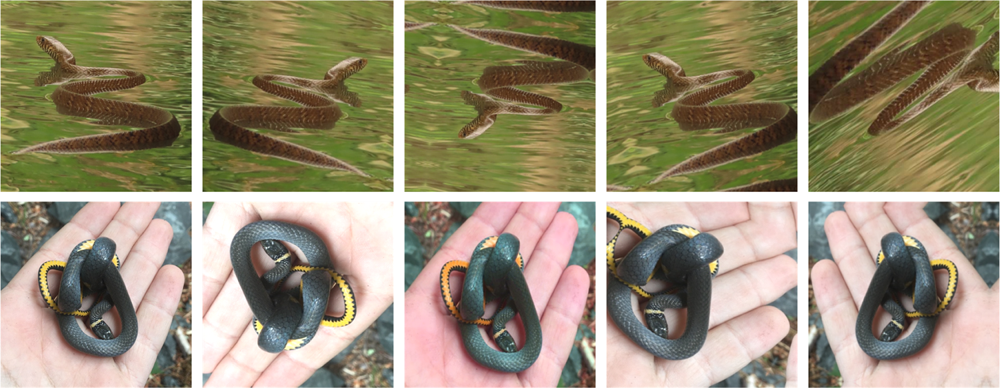

# Milestone 1 — Project Report

**Project:** Snake Identification from Images  
**Team:** Group 5 — DS and AI Lab Project  
**Report status:** Proposal and literature review
**Date:** 22 October 2026

## 1. Objective and intended use

Build and evaluate an image-based system that accepts a photograph of a snake and returns a ranked set of likely species for a defined Indian-region species list. The initial prototype should:

1. Detect whether an image plausibly contains a snake, then classify the visible snake using a transfer-learned image model.
2. Return the top three candidate species, calibrated confidence (or an explicit “uncertain / outside supported classes” result), common and scientific names, and a short explanation of useful visual cues.
3. Optionally use a user-supplied coarse location (state or region) to re-rank candidates by known range. Location must not silently override visual evidence.
4. Be usable as a research/demo tool on ordinary phone photographs, including varied backgrounds, lighting, scale, pose, and image quality.

The intended role is **decision support and education**, not a definitive field or clinical identification. A snakebite response must never be delayed or determined by this prototype. Any eventual first-aid information must be reviewed by qualified local medical authorities and shown separately from model predictions.

### Research questions

- How well can a compact pretrained vision model identify the selected regional species on a test split that separates observations, not merely image files?
- Does location information improve macro-F1 and reduce confusion among lookalikes without making the model brittle when location is missing or wrong?
- How much do long-tail balancing, targeted augmentation, and an uncertainty/rejection option improve performance on rare, visually similar, or out-of-scope snakes?
- Can the resulting model deliver useful top-k suggestions with acceptable latency on the intended hardware?

## 2. Problem and existing evidence

Snake recognition is a fine-grained visual classification problem: markings change with age and geography, similar-looking species can differ medically, and photos may show only part of an animal or include distracting backgrounds. Dataset imbalance is substantial. SnakeCLEF 2021 describes 414,424 photos across 772 species and 188 countries; the most represented species had 22,163 images while one species had only 10. Its dataset included online biodiversity observations and noisy Flickr examples, plus an expert-identified private test set. The challenge explicitly warns about age- and location-dependent morphology and venomous/non-venomous lookalikes. [SnakeCLEF 2021 challenge](https://www.aicrowd.com/challenges/snakeclef2021-snake-species-identification-challenge)

A published global Vision Transformer study trained on 386,006 photos covering 772 species from 188 countries. The dataset included 198 medically important venomous species and 574 other species. The authors report **96.0% top-1 accuracy**, **92.2% species macro-F1**, **99.0% genus top-1 accuracy**, and **94.2% country macro-F1** on a 23,673-image test set. Geographic filtering improved country F1 and species F1 by 2.93 and 3.11 percentage points respectively in their experiment, and the authors report a 33.3% relative error reduction from incorporating geographic metadata. These are strong research results on that study’s benchmark, not a promise of performance on a new Indian pilot or phone photos. [PLOS study: methods and results](https://journals.plos.org/plosntds/article?id=10.1371/journal.pntd.0010647)

The same study exposes important caveats: the data are long-tailed; only 772 of roughly 3,921 known species met the ten-image training threshold; 77% of photos came from the United States and Canada; and test images from iNaturalist may be easier than urgent field images (blur, partial bodies, or poor lighting). The authors call for field testing. Country-level F1 exceeded 90% in 88% of countries but fell as low as 36% in Martinique, illustrating that global averages can hide regional weakness. [PLOS study: dataset coverage and limitations](https://journals.plos.org/plosntds/article?id=10.1371/journal.pntd.0010647)

An earlier challenge focused on 45 North American species reported 84% accuracy and F1 0.83 on a post-challenge iNaturalist set; on expert-labelled private photos its reported accuracy was 72% across 27 represented species (and F1 0.73). Performance varied by species, and human participants did better on some poor-quality images. This is useful evidence that curated/online test results may overstate real-world reliability. [Durso et al., 2021](https://pmc.ncbi.nlm.nih.gov/articles/PMC8093445/)

SnakeCLEF 2024 shifted attention toward medically important scenarios and evaluated generalization in India, Central America, and southern Africa, including asymmetric error costs such as a venomous snake predicted harmless. This suggests that raw top-1 accuracy alone is insufficient for the proposed project. [SnakeCLEF 2024 overview](https://dspace.zcu.cz/items/64e8cf26-55b0-42a1-bc2f-ac6da22c5173)

## 3. Data samples and proposed data plan

The sample panel below is from the augmentation figure in the open-access PLOS snake-recognition study. It shows two underlying snake photographs (top and bottom rows) alongside transformed versions used to illustrate training augmentation. The original figure caption credits the source observations to chiuluan (iNaturalist 207060926) and Alex Karasoulos (iNaturalist 207359674), both marked CC-BY in the article. These examples demonstrate variation in pose, framing, background, and capture conditions; they are **illustrative literature samples, not a claim that these files are already in this project’s training set**. [Original Figure 2 and attribution](https://journals.plos.org/plosntds/article/figure?id=10.1371/journal.pntd.0010647.g002)



**Planned data sources:** begin with legally usable, research-grade iNaturalist observations and/or a released SnakeCLEF subset, after checking dataset terms, image licenses, taxonomic labels, and geographic coverage. For an India-focused pilot, prioritize species confirmed in the chosen target states, and supplement sparse species only with expert-reviewed records. Maintain source URL/observation ID, license, label provenance, and location uncertainty for each image. Deduplicate near-identical images and group all images from one observation/photographer where feasible before splitting.

**Data risks to address:** mislabeled or disputed taxa; rare classes; geographic and platform bias; repeated images of the same individual; captive snakes; class overlap and taxonomic updates; photos containing multiple snakes; and leakage when near-duplicates cross train/test splits. Keep a separate out-of-scope/unknown set and a hard, expert-reviewed lookalike subset.

## 4. Existing solutions and comparison

| Option | What it offers | Strengths | Limitations relevant to this project |
|---|---|---|---|
| Global SnakeCLEF/PLOS ViT research model | Global, fine-grained image classification with optional geography | Published large-scale benchmark; 772 species; unusually strong reported accuracy and macro-F1 | Research benchmark performance is not transferable without a matched regional evaluation; long-tail and field-image gaps remain; model/data use and deployment conditions must be checked |
| SnakeCLEF challenge systems | Shared datasets, held-out evaluation, and comparable metrics; 2024 includes India and medical-risk scenarios | Reproducible benchmark framing; emphasizes country-level and error-cost evaluation | Competition submissions are not necessarily consumer-ready products; exact test data and implementation constraints differ |
| iNaturalist Computer Vision / Seek | General species suggestions based on community observation imagery; location can inform suggestions | Broad taxa and community review; accessible user-facing workflow | Suggestions are not a snake-specific clinical decision system; coverage and suggestion quality depend on region and observation density. iNaturalist itself notes that suggestions can be less reliable where observation coverage is sparse. [iNaturalist FAQ](https://www.inaturalist.org/posts/47454-faq) |
| Regional snake identification references and expert communities | Human-readable species information and expert support, often region-specific | Local context and expert knowledge; can resolve cases that images alone cannot | Often manual and variable in response time; not a consistently measured automated benchmark |
| Proposed Group 5 prototype | Region-scoped, ranked photo predictions with optional coarse location and uncertainty handling | Can target local lookalikes, provide transparent benchmark comparisons, and explicitly abstain when evidence is weak | Must establish a reliable labelled dataset and prove performance; no project baseline or implementation exists yet |

**Key proposed difference:** the project should optimize for a defined local species set and report class-balanced and safety-relevant errors, rather than claiming global coverage. It will expose uncertainty, evaluate “dangerous confusion” separately, and test the effect of location metadata as an ablation. This is a proposal, not a demonstrated advantage.

## 5. Baselines and target improvements

### Published external baselines

| Reference | Scope/test set | Reported result | How to interpret it |
|---|---|---|---|
| Durso et al. / SnakeCLEF-era EfficientNet pipeline | 45 North American species; online and private expert-labelled test sets | 84% accuracy / 0.83 F1 on post-challenge iNaturalist; 72% accuracy / 0.73 F1 on 27-class private set | Strong early specialist baseline; private-image performance was lower |
| Global ViT study | 772 species; 23,673-image independent test | 96.0% top-1 accuracy; 92.2% species macro-F1; 94.2% country macro-F1 | Current literature reference found for broad global snake classification; not directly comparable to a new regional split |
| SnakeCLEF 2021 challenge data | 772 species; 188 countries | 414,424 images total; long-tailed class sizes of 10–22,163 | Benchmark scale and imbalance context, not itself a single model score |

### Project baseline (to be measured)

There is **no measured project baseline yet**: the repository has no dataset, training code, model, or evaluation split. At the next milestone, establish a reproducible baseline with (1) majority-class prediction, (2) a pretrained ResNet/EfficientNet classifier fine-tuned on the same training set, and (3) the same model plus location metadata. Record the split manifest, class counts, software/model versions, and random seed. Do not fill this table with invented numbers.

| Metric | Current project value | Measurement planned |
|---|---:|---|
| Top-1 accuracy | Not measured | Fraction of held-out images whose first prediction matches the reference label |
| Top-3 accuracy | Not measured | Fraction where reference label appears in the first three suggestions |
| Macro-F1 | Not measured | Mean per-class F1; reflects rare classes |
| Balanced accuracy | Not measured | Mean per-class recall |
| Calibration / selective risk | Not measured | Reliability or ECE plus error rate after abstaining below a confidence threshold |
| Dangerous confusion | Not measured | Per-class and weighted errors, especially venomous → non-venomous predictions for target region |
| Latency / model size | Not measured | Median and p95 prediction time on target hardware; artifact size |

**Improvement plan:** (a) use transfer learning and train/validation class-aware sampling or loss weighting; (b) augment realistic lighting, crop, rotation, blur, and compression without destroying diagnostic pattern cues; (c) evaluate a snake detector/crop stage against full-image classification; (d) test a location-aware re-ranker only when location is present, with geographic leakage controlled; (e) calibrate probabilities and add an unknown/abstain pathway; (f) obtain expert review for rare classes and high-cost confusions. Compare each change through controlled ablations on the exact same held-out data.

Targets should be set after collecting the first reliable split. A reasonable milestone objective is statistically better macro-F1 and top-3 recall than the pretrained regional baseline while reducing dangerous confusion, with no material regression on common species. The global ViT’s 96% top-1 and 92.2% macro-F1 are reference points, not promises or pass thresholds for a different dataset.

## 6. Evaluation against the best available options

Use a **locked, observation-level test set** with expert-verified labels, class counts, region, source, and image-quality strata. Split by observation and, where possible, contributor/individual to prevent near-duplicate leakage. Keep a second external set from a different source or collection period for a more realistic distribution-shift test.

1. Run the project baseline and every proposed model on identical images and label mappings.
2. Where downloadable/reusable checkpoints or accessible tools permit, run the published global model and/or a SnakeCLEF 2024 reference solution on the same supported classes. For iNaturalist or other user-facing tools, record the returned ranked suggestions on the same images, with tool/version/date, location settings, and missing/unsupported cases. If direct execution is unavailable, mark that comparison unavailable rather than inferring a score from a paper.
3. Report top-1 and top-3 accuracy, macro-F1, per-class precision/recall, balanced accuracy, confusion matrices, calibration, coverage-versus-risk for abstention, and latency/model size. Provide bootstrap confidence intervals and group results by common/rare classes, region, quality, and medically important status.
4. Predefine an asymmetric error analysis. Count venomous-to-nonvenomous confusions separately; report sensitivity/recall for medically important species and a cost-weighted score alongside standard metrics. Never collapse this into a single accuracy claim.
5. Test location use with three settings: image only, image plus correct coarse location, and image plus missing/incorrect location. This reveals whether geography helps and whether it can harm.
6. Have herpetology reviewers inspect a stratified sample of errors, uncertain predictions, and high-risk predictions. Compare model output with expert labels and, where feasible, independent human identification on the same blinded test examples.

**Market comparison caveat:** iNaturalist/Seek and regional services are useful practical comparators, but their coverage, models, and interfaces change over time and they do not publish a directly comparable snake-only score on this project’s proposed test set. A fair “best available” claim requires executing the tools against the same locked images; until then, the report treats the literature ViT and SnakeCLEF as research baselines and consumer tools as workflow references.

## 7. Expected product outputs (illustrative mockups)

These are mock outputs for the proposed interface, not predictions produced by a trained model.

### Example A — confident, in-scope photo

```text
┌──────────────────────────────────────────────┐
│ Snake image analyzed                          │
│                                              │
│ 1. Candidate species A                 0.82  │
│ 2. Candidate species B                 0.11  │
│ 3. Candidate species C                 0.04  │
│                                              │
│ Region: user-selected state                   │
│ Visual cues: band pattern; head/body shape    │
│ Confidence: review recommended                │
│ [View species notes] [Report a correction]    │
└──────────────────────────────────────────────┘
```

A real release should show verified common/scientific names and concise, sourced distinguishing features. Percentages are placeholders and must not be read as actual model confidence.

### Example B — uncertain or unsupported image

```text
┌──────────────────────────────────────────────┐
│ No reliable species-level match               │
│                                              │
│ Best supported level: Genus / Unknown         │
│ Top candidates are visually similar.          │
│ Confidence is below the display threshold.    │
│                                              │
│ Please do not handle the snake.               │
│ [Retake from a safe distance] [See guidance]  │
└──────────────────────────────────────────────┘
```

The “guidance” content requires local expert/medical review. The model should never present a low-confidence species guess as certainty.

## 8. Gaps, opportunities, and project response

| Gap in existing work | Opportunity | Planned response |
|---|---|---|
| Long-tailed data and weak coverage for rare species | Use class-aware evaluation and seek expert-verified regional additions | Track per-class sample counts; avoid presenting macro performance alone; focus curation on rare target species |
| Geographic bias and domain shift | Evaluate a bounded local use case with a second-source test set | Define the regional list, keep location as an optional feature, measure cross-region/source performance |
| Similar-looking species with different risk | Make confusion costs explicit | Report venomous → non-venomous errors and medically important recall; use abstention when ambiguous |
| Online benchmark images may be cleaner than incident photos | Curate hard, real-world examples | Add blurred, partial, low-light, and cluttered images with expert labels; test separately |
| High headline accuracy can mask rare-class failure and overconfidence | Calibrate and communicate uncertainty | Include macro-F1, class-level results, calibration, top-k candidates, and unknown detection |
| Global research model may be difficult to adapt/deploy locally | Build a reproducible, appropriately sized student prototype | Compare efficient pretrained backbones, model size, and inference time on agreed hardware |
| Consumer tools do not offer directly comparable snake-specific scores | Run matched-image comparative evaluation | Freeze test images and tool settings; report date/version and unsupported predictions |

## 9. Milestone 1 conclusion and next work

The literature establishes that image-based snake classification is feasible and that a large ViT system has reported strong global benchmark performance. It also shows why a new project must not rely on accuracy alone: data imbalance, geographic representation, difficult field images, lookalike species, and risk-asymmetric mistakes are central challenges. The proposed contribution is a transparent, region-scoped prototype with a fair matched-set comparison, optional location conditioning, top-k output, and explicit uncertainty handling.

**Immediate next steps:** confirm target geography/species and user; choose a license-compatible dataset; define expert label policy and medically important taxonomy; create grouped train/validation/test manifests; build the simple pretrained baseline; then lock metrics and acceptance criteria before tuning.

## References

1. Picek et al. (2021), [SnakeCLEF 2021 challenge description and dataset](https://www.aicrowd.com/challenges/snakeclef2021-snake-species-identification-challenge).
2. Picek et al. (2022), [An artificial intelligence model to identify snakes from across the world](https://journals.plos.org/plosntds/article?id=10.1371/journal.pntd.0010647), *PLOS Neglected Tropical Diseases*.
3. Durso et al. (2021), [Supervised learning computer vision benchmark for snake species identification from photographs](https://pmc.ncbi.nlm.nih.gov/articles/PMC8093445/), *Frontiers in Artificial Intelligence*.
4. Picek et al. (2024), [Overview of SnakeCLEF 2024: Revisiting Snake Species Identification in Medically Important Scenarios](https://dspace.zcu.cz/items/64e8cf26-55b0-42a1-bc2f-ac6da22c5173).
5. iNaturalist, [Computer Vision FAQ](https://www.inaturalist.org/posts/47454-faq) and [Seek app information](https://www.inaturalist.org/pages/seek_app).

<div style="page-break-before: always"></div>

# Team review and acknowledgment

**This is the final page of the report. Each team member must complete and sign one row before submission.** By signing, each member confirms that they have reviewed the submitted document, understand its contents, and agree with the submission.

| Team member name | Roll Number | Signature / acknowledgment | Date |
|---|---|---|---|
|Jayesh Bansal|24f100189||22/10/2026|
|  |  |  |  |
|  |  |  |  |
|  |  |  |  |
